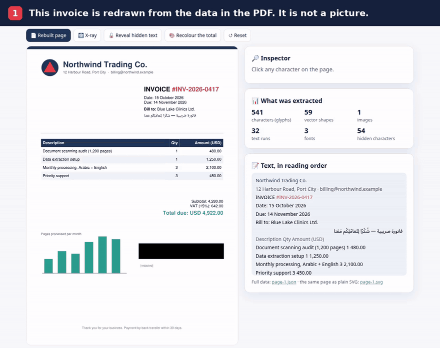
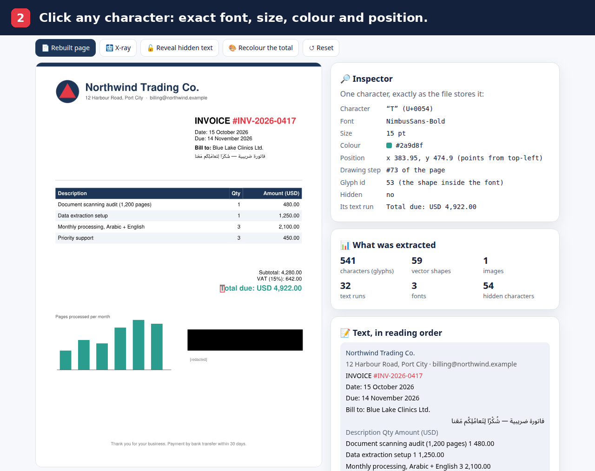
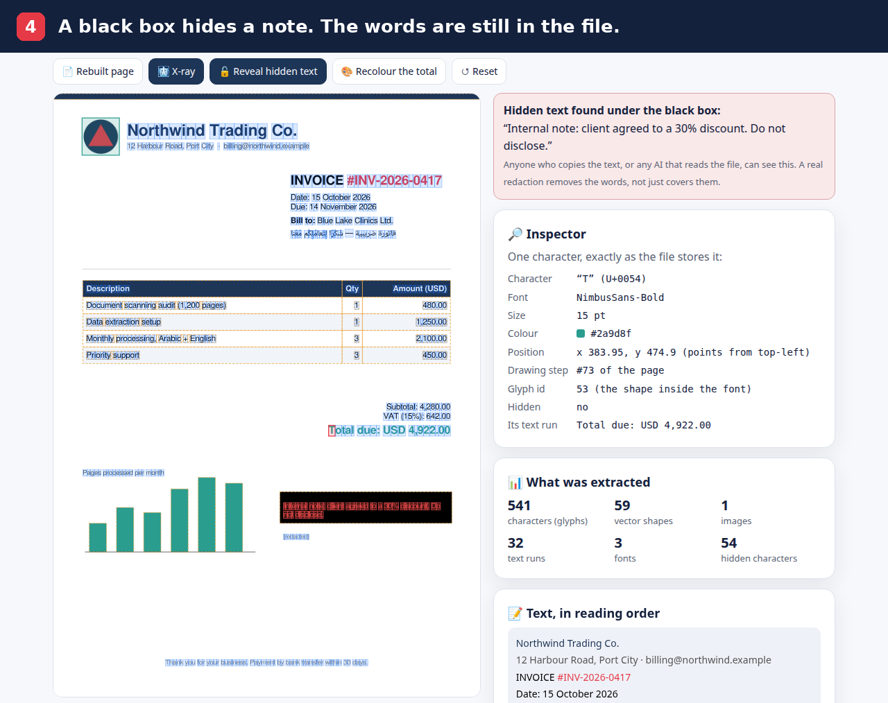
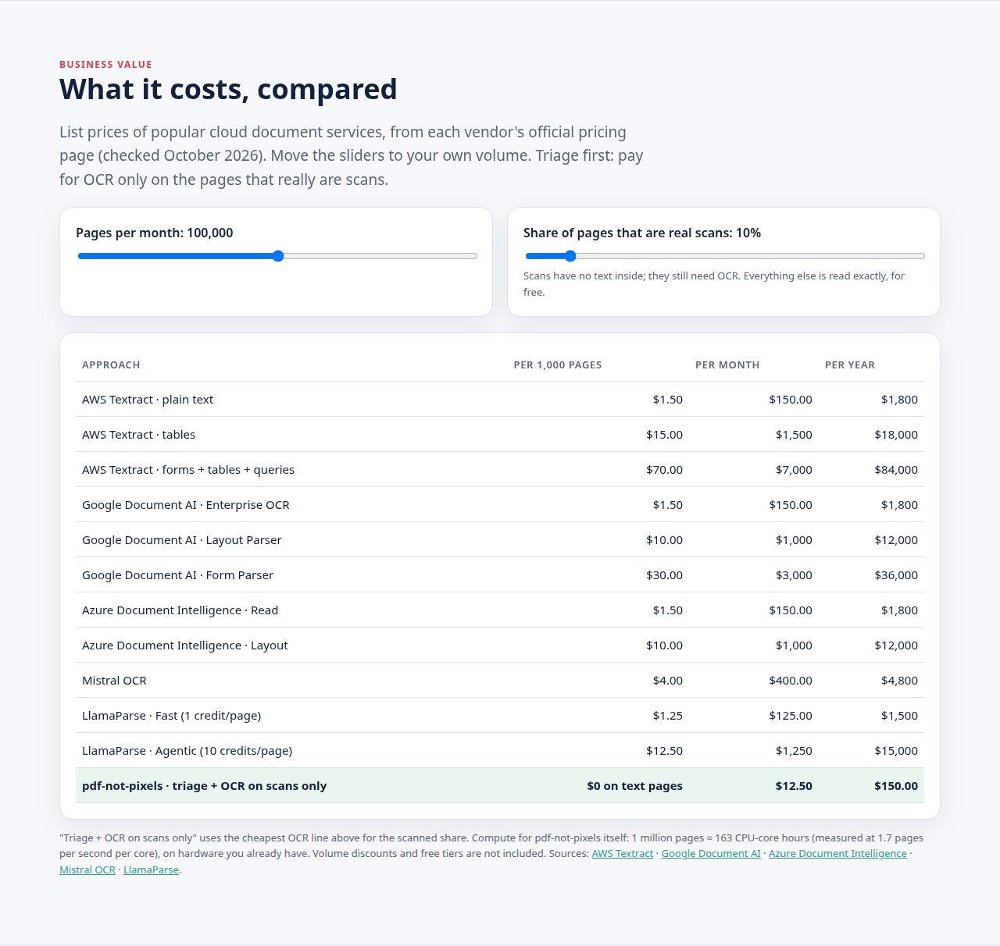
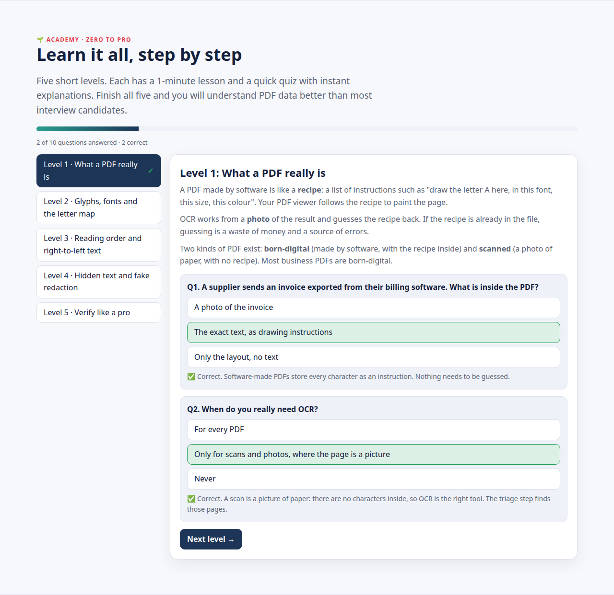
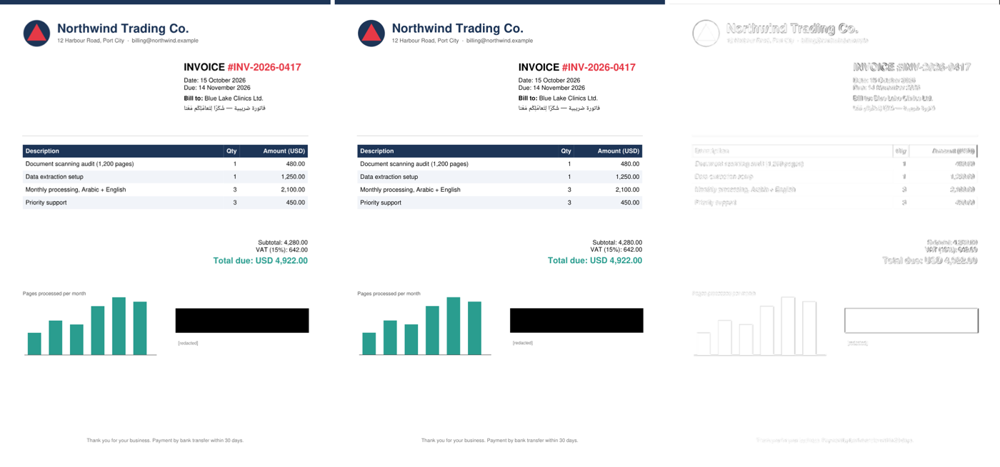

<div align="center">

# 📄 pdf-not-pixels

### Read the PDF, not the picture of it.

**Exact text, layout, colours and hidden content from PDFs, with no OCR, no AI guessing and no per-page fees.**

[](LICENSE)
[](requirements.txt)
[](#-when-you-still-need-ocr)

[**▶ Live demo and interactive course**](https://m0-ar.github.io/pdf-not-pixels/) ·
[Executive summary](#-executive-summary) · [Cost comparison](#-what-it-saves) · [Quick start](#-quick-start) ·
[Beginner guide](#-beginner-guide--read-this-and-you-are-a-professional)



</div>

> **New to PDFs?** Read the [🌱 Beginner guide](#-beginner-guide--read-this-and-you-are-a-professional).
> You will know more than most interview candidates.

---

## 🧭 Executive summary

1. **The problem.** Companies pay OCR and AI services to *re-read* their PDFs from pictures. Those services guess
   every letter, make small errors (a wrong digit, a lost accent), and charge for every page.
2. **The insight.** Most business PDFs are made by software: Word, Excel, billing systems, design tools. Such a PDF
   is not a picture. It is a list of exact drawing instructions, and **every character is already inside it**.
3. **The product.** pdf-not-pixels reads those instructions and turns each page into clean, structured data: every
   character, number, colour and position, in reading order, including right-to-left languages such as Arabic and
   Hebrew.
4. **The proof.** It rebuilds each page from the extracted data alone and compares it with the original. On real
   documents the rebuilt pages match at **0.976 to 0.9985** similarity (1.0 = identical).
5. **The bonus.** It finds text that is **in the file but invisible on the page**, such as a "redaction" made with a
   black box. Anyone can still copy that text. Most tools never notice it.

**Bottom line:** for born-digital PDFs you get exact data, on your own machines, for the cost of your own CPU time.
Only true scans still need OCR, and the built-in triage tells you exactly which pages those are.

---

## 📚 Contents

- [The idea in one minute](#-the-idea-in-one-minute)
- [What you get](#-what-you-get)
- [See it in action](#-see-it-in-action)
- [What it saves](#-what-it-saves)
- [Who it is for: use cases and user stories](#-who-it-is-for-use-cases-and-user-stories)
- [Quick start](#-quick-start)
- [🌱 Beginner guide: read this and you are a professional](#-beginner-guide--read-this-and-you-are-a-professional)
- [How it works](#%EF%B8%8F-how-it-works)
- [The tools, one by one](#-the-tools-one-by-one)
- [The data you get](#%EF%B8%8F-the-data-you-get)
- [Proof: measured results](#-proof-measured-results)
- [When you still need OCR](#-when-you-still-need-ocr)
- [Limits and roadmap](#-limits-and-roadmap)
- [FAQ](#-faq)
- [Project layout](#-project-layout)
- [License](#-license)

---

## 💡 The idea in one minute

Think of a cake.

- **OCR and vision AI** look at a **photo** of the cake and try to guess the recipe. They are often close, sometimes
  wrong, and you pay for every photo.
- **pdf-not-pixels** opens the **recipe book**. For most PDFs, the recipe is right there inside the file.

This is what a page looks like inside a PDF:

```text
draw glyph 57 of font F2, size 12, at (151.8, 178.6), colour #c00000
fill this path with #3373b2
draw image 3 in the box (420, 320, 540, 380)
draw glyph 58 …
```

Your PDF viewer follows these instructions to paint the page. pdf-not-pixels follows the **same** instructions, but
writes down what each one says instead of painting it. Nothing is guessed, because nothing needs to be.

| | OCR / vision AI | pdf-not-pixels |
|---|---|---|
| Works from | a picture of the page | the file's own instructions |
| Characters | guessed | read exactly as stored |
| Accents and diacritics (é, ü, شَدّة) | often lost or moved | kept, on the right letter |
| Colours, fonts, exact positions | approximate or missing | exact, for every character |
| Hidden text under boxes | invisible to it | detected and reported |
| Same file, same output? | not guaranteed | always |
| Cost | per page, often per feature | your own CPU time |
| Your data | usually sent to a cloud service | stays on your machines |
| Scanned paper | ✅ the right tool | ❌ use OCR (triage finds those pages) |

---

## 🎁 What you get

| Feature | What it means for you |
|---|---|
| **Exact text in reading order** | Every word as the author typed it, including right-to-left scripts and diacritics. |
| **Full layout data** | Position, size, font and colour of every character; every shape and image with its box. |
| **Pixel-faithful rebuild** | Each page can be redrawn from the data alone (SVG), so you can prove the data is complete. |
| **Hidden-text detection** | Text under a black box, or covered by another shape, is found and reported. |
| **Triage** | Sorts pages into real text, scans (need OCR) and words-turned-into-shapes, so you only pay OCR for scans. |
| **Text repair from shapes** | When a file names a letter wrongly, you fix it once per font, by looking at the shape. |
| **Runs locally** | No cloud, no API key, no per-page fee, no data leaving your machines. |
| **Deterministic** | The same file always gives the same data: easy to audit and to test. |
| **Open and small** | About 700 lines of readable Python. MIT licensed: use it commercially. |

---

## 🎬 See it in action

The [live demo](https://m0-ar.github.io/pdf-not-pixels/) runs in your browser. It takes
[a sample invoice](examples/demo-invoice.pdf) apart: the page you see is **drawn from the extracted data**, not
shown as an image.

| Click any character | Reveal what a black box hides |
|---|---|
|  |  |
| Exact font, size, colour, position and drawing step of every character. | The note under the box is still in the file: *"Internal note: client agreed to a 30% discount. Do not disclose."* |

| Cost calculator | Academy: zero to pro |
|---|---|
|  |  |
| Move two sliders: pages per month and share of scans. Official list prices, October 2026. | Five short levels, each with a lesson and a quiz with instant explanations. |

**Proof on every page:** the page rebuilt from data (left), the original PDF (middle) and their difference (right).
The difference is almost empty: similarity **0.9968**.



---

## 💰 What it saves

List prices of popular cloud document services, taken from each vendor's **official pricing page in October 2026**,
for **100,000 pages a month**:

| Service | Price per 1,000 pages | Per month | Per year |
|---|---:|---:|---:|
| AWS Textract: plain text | $1.50 | $150 | $1,800 |
| AWS Textract: tables | $15.00 | $1,500 | $18,000 |
| AWS Textract: forms + tables + queries | $70.00 | $7,000 | $84,000 |
| Google Document AI: Enterprise OCR | $1.50 | $150 | $1,800 |
| Google Document AI: Layout Parser | $10.00 | $1,000 | $12,000 |
| Google Document AI: Form Parser | $30.00 | $3,000 | $36,000 |
| Azure Document Intelligence: Read | $1.50 | $150 | $1,800 |
| Azure Document Intelligence: Layout | $10.00 | $1,000 | $12,000 |
| Mistral OCR | $4.00 | $400 | $4,800 |
| LlamaParse: Fast (1 credit per page) | $1.25 | $125 | $1,500 |
| LlamaParse: Agentic (10 credits per page) | $12.50 | $1,250 | $15,000 |
| **pdf-not-pixels, if 10% of pages are scans** (OCR only on those, at the cheapest rate above) | **$0 on text pages** | **$12.50** | **$150** |
| **pdf-not-pixels, born-digital documents only** | **$0** | **$0** | **$0** |

- **Compute instead of fees:** it runs at **1.7 pages per second on one CPU core**, measured on an Intel i7-14700F.
  One million pages is about 163 CPU-core hours on hardware you already own.
- **Not included above:** volume discounts, free tiers and commitment plans.
- **The other side of the value:** layout-aware cloud services return more than text (tables, form fields). What
  pdf-not-pixels gives you instead is the exact characters with exact positions, colours and fonts, from which tables
  and fields can be rebuilt without guessing.
- **Try your own numbers:** the [live cost calculator](https://m0-ar.github.io/pdf-not-pixels/#cost).

Sources:
[AWS Textract](https://aws.amazon.com/textract/pricing/) ·
[Google Document AI](https://cloud.google.com/document-ai/pricing) ·
[Azure Document Intelligence](https://azure.microsoft.com/en-us/pricing/details/ai-document-intelligence/) ·
[Mistral OCR](https://mistral.ai/news/ocr-4/) ·
[LlamaParse](https://developers.llamaindex.ai/llamaparse/general/pricing/)

---

## 👥 Who it is for: use cases and user stories

| Team | User story | What they use |
|---|---|---|
| 💼 **Accounts payable** | *As a finance lead, I want invoice totals read exactly from supplier PDFs, so that no payment is ever based on a misread digit.* | `extract.py` → `lines` |
| ⚖️ **Legal and compliance** | *As a compliance officer, I want every outgoing PDF checked for hidden text under black boxes, so that a bad redaction never leaks a client's secret.* | `triage.py` → hidden text |
| 🤖 **AI and search teams** | *As an AI engineer, I want clean text with layout from thousands of PDFs, so that our chatbot answers from the real words, without an OCR bill.* | `extract.py` → `lines` |
| 📚 **Publishers and education** | *As a publisher, I want books turned into accessible, searchable data with every Arabic or Hebrew diacritic intact, so that readers get the exact text.* | `extract.py` + glyph repair |
| 🗄️ **Archives and data teams** | *As a data manager, I want to know which of our 2 million PDFs are real scans, so that we send only those to OCR and save the rest of the budget.* | `triage.py` |
| 🎨 **Design and localisation** | *As a designer, I want to rebuild a page as editable SVG, so that I can recolour, restyle or translate it without starting from scratch.* | `render.py` |
| 🧪 **Quality assurance** | *As a QA engineer, I want two versions of a report compared character by character, so that I know exactly what changed.* | `extract.py` on both versions |
| ♿ **Accessibility** | *As an accessibility lead, I want the true reading order of every page, including right-to-left text, so that screen readers read it correctly.* | `extract.py` → `lines` |
| 🏛️ **Government and records** | *As a records officer, I want documents processed on our own servers, so that sensitive files never go to a cloud service.* | everything (it runs locally) |

---

## 🚀 Quick start

```bash
git clone https://github.com/M0-AR/pdf-not-pixels.git && cd pdf-not-pixels
pip install -r requirements.txt && playwright install chromium
python3 tools/triage.py  examples/demo-invoice.pdf
python3 tools/extract.py examples/demo-invoice.pdf 1 --out out --fixes examples/demo-fixes.json
python3 tools/render.py  out/page-1.json && python3 tools/check.py examples/demo-invoice.pdf 1 out/page-1.svg
```

What you will see (real output):

```text
1 pages: 1 with real text, 0 image-only (need OCR), 0 blank
  page 1: HIDDEN TEXT: "Internal note: client agreed to a 30% discount. Do not disclose."
page 1: 59 shapes, 609 glyphs, 1 images, 32 text runs -> out/page-1.json
{"font_spans_with_several_subsets": 32, "glyphs_unmapped": 0, "glyphs_without_outline_font": 0, "glyphs_hidden": 54}
-> out/page-1.svg
similarity 0.9968  (side by side: out/check-1.png)
```

- `out/page-1.json` holds all the data.
- `out/page-1.svg` is the page rebuilt from that data.
- `out/check-1.png` shows the rebuilt page, the original and their difference, side by side.

To open the live demo locally, run `python3 -m http.server` in the repo folder, then go to
<http://localhost:8000/preview.html>.

---

## 🌱 Beginner guide — read this and you are a professional

No experience needed. Read it top to bottom, one step at a time. Each step builds on the one before.

### Step 1. A PDF is a recipe, not a photo

When a program "saves as PDF", it does not take a photo of your document. It writes a **list of instructions**:
"draw the letter *A* here, in this font, at this size, in this colour"; "fill this rectangle with blue"; "put this
image in this box". Your PDF viewer reads the list and paints the page.

👉 **Key idea:** the text is already in the file. You don't need to "see" it; you can read it.

### Step 2. There are two kinds of PDF

| Kind | How it was made | What is inside | What to use |
|---|---|---|---|
| **Born-digital** | Exported by software (Word, Excel, billing systems, LaTeX, InDesign, browsers) | Exact instructions, text included | **pdf-not-pixels** |
| **Scanned** | A photo or scan of paper | One big picture per page, no letters | **OCR** |

Most business documents (invoices, contracts, reports, statements) are born-digital.
`python3 tools/triage.py file.pdf` tells you which kind each page is.

### Step 3. What a page contains

A page is drawn from just three kinds of thing:

- **Glyphs:** the shapes of letters, digits and symbols. Each has a font, a size, a colour and an exact position.
- **Shapes (vector paths):** lines, boxes, table borders, charts, logos.
- **Images:** photos and pictures, each placed in a box.

They are drawn **one after another**. The order matters: something drawn later is painted **on top of** something
drawn earlier. We call this the *drawing order*, and every item keeps its number (`seq`).

### Step 4. Fonts, glyph ids and the letter map

- **The glyph id.** A font is a box of shapes. The page doesn't say "draw the letter A". It says "draw shape number
  36 of font F1". That number is the **glyph id**.
- **The letter map.** A separate table in the file (called *ToUnicode*) says which letter each shape means:
  shape 36 = "A". That is how text can be copied out of a PDF.
- **When the map is wrong.** Sometimes the letter map is missing or wrong, but the **shape is always right**. So
  `tools/glyph_sheet.py` draws every shape next to the letter the file claims for it. You fix the wrong ones once,
  in a small file, and the fix applies to the whole document.
- **Exact redrawing.** The fonts are embedded in the PDF, so we can also redraw every glyph exactly, with no fonts
  installed.

### Step 5. From drawing order to reading order

Programs draw letters in whatever order is convenient, usually **left to right**, even for Arabic or Hebrew. To get
readable text:

1. **Group letters into lines** by their baseline, the invisible line letters sit on.
2. **Sort each line in its reading direction:** right to left for Arabic and Hebrew, keeping numbers and Latin words
   left to right inside them.
3. **Attach each accent or diacritic** (é, ü, Arabic harakat) to the letter it is **drawn on**.
4. **Find the spaces.** Some programs never store spaces; a gap wider than about a fifth of the font size is a space.

### Step 6. Hidden text and fake redaction

Because later items are painted on top, a black box drawn over a sentence **hides** it on screen, but the sentence
is **still in the file**. Copy-paste, search, screen readers and AI tools can all still read it. That is how secrets
leak from "redacted" PDFs.

pdf-not-pixels checks what is really visible on the rendered page and marks covered text as `hidden`. The demo
invoice has one: *"Internal note: client agreed to a 30% discount. Do not disclose."*

👉 **Key idea:** a real redaction **removes** the words. Covering them is not enough.

### Step 7. Prove it is right

Never just trust extracted data: check it.

1. **Rebuild:** redraw the page from the data alone (`render.py`).
2. **Compare:** put the rebuild next to the original rendering, pixel by pixel (`check.py`). A similarity close to
   **1.0** means the data really describes the page.
3. **Count:** check glyphs without a letter (`glyphs_unmapped`), glyphs without a shape
   (`glyphs_without_outline_font`) and hidden glyphs. Every non-zero number needs a reason.
4. **Re-run everything after a fix,** and compare the new text with the old, word by word. A fix for one page must
   not quietly break another.

### Step 8. Your first real run

Run the [Quick start](#-quick-start) commands, then open these:

- `out/page-1.json`: find the `lines` list. That is the text in reading order.
- `out/page-1.svg`: open it in a browser. It looks like the PDF, but it was drawn from the data.
- `out/check-1.png`: the rebuilt page, the original and their difference.

Then try your own PDF: `python3 tools/triage.py your.pdf`.

### Glossary

| Word | Meaning |
|---|---|
| **Born-digital PDF** | A PDF made by software. It contains exact instructions and text. |
| **Scanned PDF** | A PDF made from a photo or scan. It contains pictures, not letters. |
| **OCR** | Optical Character Recognition: guessing letters from a picture. |
| **Glyph** | The drawn shape of a letter, digit or symbol. |
| **Glyph id** | The number of a shape inside a font. |
| **ToUnicode (letter map)** | The table that says which letter each glyph means. |
| **Embedded font** | A font stored inside the PDF, so the exact shapes are available. |
| **Drawing order (`seq`)** | The order items are painted. Later items cover earlier ones. |
| **Reading order** | The order a person reads the text in. |
| **RTL** | Right-to-left scripts, such as Arabic and Hebrew. |
| **Diacritic** | A small mark on a letter: é, ü, or Arabic harakat such as fatha and shadda. |
| **Hidden text** | Text that is in the file but covered on the page. |
| **Outlined text** | Words converted into vector shapes. They look like text but contain no letters. |
| **Similarity** | How close the rebuilt page is to the original: 1.0 means identical. |

### Interview questions you can now answer

<details><summary>1. Why is OCR the wrong tool for a PDF exported from Word?</summary>

Because the PDF already contains every character as an instruction. OCR would throw that away, render a picture,
and guess the letters back: slower, more expensive and less accurate.
</details>

<details><summary>2. How can you tell a scanned page from a born-digital page?</summary>

A scanned page is one image covering the page, with few or no glyphs. A born-digital page draws glyphs.
`tools/triage.py` does this check for every page.
</details>

<details><summary>3. Text copied from a PDF has wrong letters, but the page looks right. Why, and how do you fix it?</summary>

The file's letter map (ToUnicode) is wrong for some glyphs. The shapes are right, so draw every glyph next to its
claimed letter (`glyph_sheet.py`), correct the wrong ones in a fixes file, and re-extract.
</details>

<details><summary>4. Why does Arabic text sometimes come out reversed?</summary>

The PDF draws letters left to right. Arabic must be put back in right-to-left reading order, with numbers and Latin
words kept left to right inside it.
</details>

<details><summary>5. A contract has a black box over a name. Is the name gone?</summary>

Not necessarily. If the box was drawn on top, the name is still in the file. Drawing order shows that it is covered;
it should have been removed.
</details>

<details><summary>6. How do you prove an extraction is complete?</summary>

Rebuild the page from the extracted data alone and compare it with the original. If they match, nothing important is
missing. Then re-run every page after each fix.
</details>

👉 **Learn it interactively:** the [Academy](https://m0-ar.github.io/pdf-not-pixels/#academy) has five short
levels with quizzes and instant explanations.

---

## ⚙️ How it works

```text
        your.pdf
           │
   ┌───────▼────────┐   real text / image-only (needs OCR) / outlined text / hidden text
   │ 1. triage      │──────────────────────────────────────────────────────────────▶ report
   └───────┬────────┘
   ┌───────▼────────┐   every glyph, shape and image, with position, colour and drawing order
   │ 2. read        │
   └───────┬────────┘
   ┌───────▼────────┐   each glyph's exact outline from the fonts embedded in the file
   │ 3. shapes      │
   └───────┬────────┘
   ┌───────▼────────┐   reading order, right-to-left, diacritics, spaces, hidden text
   │ 4. text        │──────────────────────────────────────────────────────────────▶ page-N.json
   └───────┬────────┘
   ┌───────▼────────┐   redraw from the data alone, then compare with the original
   │ 5. rebuild     │──────────────────────────────────────────────────────────────▶ page-N.svg + score
   └───────┬────────┘
   ┌───────▼────────┐   when the file names a letter wrongly: fix it once per font, by its shape
   │ 6. repair      │──────────────────────────────────────────────────────────────▶ fixes.json
   └────────────────┘
```

The full method, with every pitfall real files contain and how each one is handled, is in
**[METHOD.md](METHOD.md)**.

---

## 🧰 The tools, one by one

| Command | Input | Output | Use it to |
|---|---|---|---|
| `tools/triage.py file.pdf [--json r.json]` | a PDF | a page-by-page report | find scans, outlined text and hidden text before anything else |
| `tools/extract.py file.pdf N [--out DIR] [--fixes f.json]` | a PDF and a page number (from 1) | `DIR/page-N.json` and the page's images | get all the data for one page |
| `tools/render.py DIR/page-N.json` | the page data | `DIR/page-N.svg` | rebuild the page from data alone |
| `tools/check.py file.pdf N DIR/page-N.svg` | the PDF and the rebuild | a similarity score and a side-by-side image | prove the data is complete |
| `tools/glyph_sheet.py DIR/page-*.json` | page data | an HTML sheet of every glyph | repair a file's wrong letter map |

Use it from Python, too:

```python
import sys; sys.path.insert(0, 'tools')
from extract import extract

page = extract('examples/demo-invoice.pdf', 1)
for line in page['lines']:
    print(line['text'], line['color'])          # Total due: USD 4,922.00 #2a9d8f
hidden = [g['text'] for g in page['glyphs'] if g['hidden']]
```

---

## 🗂️ The data you get

Each page becomes one JSON file. Positions are in PDF points (1/72 inch), measured from the top-left corner.

| Key | What it holds |
|---|---|
| `page` | page number, width, height |
| `glyphs` | **every drawn character:** `text`, `font`, `size`, `color`, origin `x`/`y`, `bbox`, `dir` (writing direction), `mode` (fill / stroke / invisible), `hidden`, `seq` (drawing order), `gid` (glyph id) |
| `lines` | **the text in reading order:** runs of same-style text with `text`, `bbox`, `color`, `font`, `size`, `direction` (ltr / rtl); runs with the same `line` number share a baseline |
| `shapes` | every vector path: SVG path data, `fill`, `stroke`, `width`, opacity, `seq` |
| `images` | every image: `bbox`, saved `file`, `drawn` (false for images used only as masks), `seq` |
| `fonts` | for each embedded font: units per em and the outline of every glyph used |
| `report` | numbers to check: `glyphs_unmapped`, `glyphs_without_outline_font`, `glyphs_hidden`, `font_spans_with_several_subsets` |

One real glyph (the "T" of "Total due" on the demo invoice):

```json
{"text": "T", "gid": 53, "font": "NimbusSans-Bold", "x": 383.95, "y": 474.9, "bbox": [383.95, 463.24, 393.11, 478.24],
 "size": 15.0, "dir": [1.0, 0.0], "color": "#2a9d8f", "mode": "fill", "seq": 73, "hidden": false}
```

And the run it belongs to, in `lines`:

```json
{"text": "Total due: USD 4,922.00", "line": 14, "bbox": [383.95, 463.24, 554.0, 478.24], "font": "NimbusSans-Bold",
 "size": 15.0, "color": "#2a9d8f", "direction": "ltr"}
```

---

## 📏 Proof: measured results

| Document | What is in it | Result |
|---|---|---|
| [Demo invoice](examples/demo-invoice.pdf) | English and Arabic with diacritics, a table, a logo, a chart, a "redacted" note | Rebuilt at **0.9968** · all text exact after a 2-glyph repair · hidden note found |
| Sample report (`examples/make_sample.py`) | English and Arabic, colours, a vector chart, an image, text under a box | Rebuilt at **0.9985** · hidden sentence found |
| 19-page research paper (LaTeX, from arXiv) | Classic PostScript fonts, maths, figures, a rotated margin stamp | Every page rebuilt from its own glyph outlines · **0.976 to 0.997**, median 0.986 |
| Speed | the same 19 pages, 46,644 glyphs | **1.7 pages per second** on one CPU core |

The tests in `tests/` check the generated sample and the demo invoice, including the browser comparison: `python3 -m pytest -q tests/`.

---

## 📷 When you still need OCR

pdf-not-pixels is honest about where it stops. Run `tools/triage.py` first; it tells you which case each page is.

- **Scans and photos.** A page that is one big picture has no instructions to read. Use OCR, but only for those
  pages.
- **Text inside images.** Screenshots, photos and scanned figures need OCR too.
- **Outlined text.** Some design tools convert headings into vector shapes. They look like text but contain no
  letters.
- **Invisible OCR layers.** Some PDFs are scans with OCR text added invisibly by someone else. Those glyphs are
  marked `mode: invisible`, and their text carries that OCR's errors.

---

## 🧱 Limits and roadmap

**Not handled yet:**
- **Visual effects:** soft shadows and feathering (transparency soft masks and blend modes). Pages with them look a
  little darker when rebuilt; their text is not affected.
- **Clipping paths, gradients, annotations and form fields.**
- **Type 3 fonts**, common in charts made with matplotlib: their glyphs fall back to plain text when rebuilt.
- **Two-column layouts:** lines are split into blocks, but whole columns are not ordered yet.

**Next on the roadmap:**
- Column and table reconstruction.
- Transparency effects.
- Batch processing of whole folders.
- A command that repairs a font's letter map from a glyph sheet in one step.

---

## ❓ FAQ

<details><summary><b>Is this OCR?</b></summary>

No. OCR guesses letters from a picture. This reads the letters already stored in the file, the same ones your PDF
viewer uses to draw the page.
</details>

<details><summary><b>Does it use AI?</b></summary>

No. Every result comes from the file itself, so the same file always gives the same data. You can feed the exact
text to an AI afterwards.
</details>

<details><summary><b>Does my data leave my computer?</b></summary>

No. It runs on your own machine or server. There is no cloud service and no per-page fee.
</details>

<details><summary><b>Which PDFs does it work on?</b></summary>

Any PDF made by software: Word, Excel, Google Docs, InDesign, LaTeX, browsers, billing and reporting systems.
Scanned paper needs OCR; `triage.py` finds those pages.
</details>

<details><summary><b>Does it handle Arabic, Hebrew and other right-to-left scripts?</b></summary>

Yes. Text comes out in reading order, with each diacritic attached to the right letter. The demo invoice has an
Arabic line with diacritics.
</details>

<details><summary><b>What if the text comes out wrong?</b></summary>

Check `report.glyphs_unmapped`, then run `tools/glyph_sheet.py`. It shows every glyph next to its claimed letter.
Correct the wrong ones in a fixes file (`{"font name": {"glyph id": "letter"}}`) and pass it with `--fixes`. See
`examples/demo-fixes.json`.
</details>

<details><summary><b>Can I use it in a commercial product?</b></summary>

Yes. It is MIT licensed: use it, change it and sell products built on it. Keep the license notice.
</details>

<details><summary><b>How fast is it?</b></summary>

About 1.7 pages per second on one CPU core, measured on a 19-page research paper. Run pages in parallel to use
every core.
</details>

---

## 📁 Project layout

```text
README.md              this page
METHOD.md              the full method, step by step, with every pitfall and how to handle it
preview.html           the live demo, cost calculator and course (published with GitHub Pages)
tools/
  triage.py            sort pages: real text / scan / outlined text; find hidden text
  extract.py           PDF page -> page data (JSON)
  render.py            page data -> SVG, drawn from the data alone
  check.py             rebuilt page vs original, in a real browser: score + side-by-side image
  glyph_sheet.py       every glyph next to its claimed letter, to repair wrong letter maps
examples/
  demo-invoice.pdf     the demo invoice (made by make_demo.py); demo-fixes.json repairs its 2 unmapped glyphs
  make_sample.py       builds sample.pdf, used by the tests; sample-fixes.json repairs it
  make_media.py        records the GIF, video and screenshots from the live demo
site/
  demo/                the demo invoice's extracted data, used by the live demo
  media/               GIF, video and screenshots
tests/test_tools.py    checks on the sample, including the browser comparison
```

---

## 🤝 Work with us

Want it adapted to your documents (invoices, contracts, statements, books) or built into your pipeline?
[Open an issue](https://github.com/M0-AR/pdf-not-pixels/issues) describing your documents and volume.

## 📜 License

[MIT](LICENSE): free to use, change and sell. Keep the license notice.
